
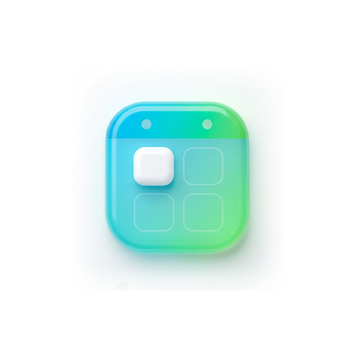

<h1 align="center">Classy</h1>

<strong>MAKE TIME YOURS.</strong> Free, open-source and ad-free. Your classes, from today to the whole semester — on your phone, tablet and home screen.

<a href="https://github.com/IMSX3D/Classy/releases/latest"><strong>Download for Android ↗</strong></a> · <a href="../README.md">简体中文</a> · <a href="GUIDE.zh-CN.md">User guide (Chinese)</a>

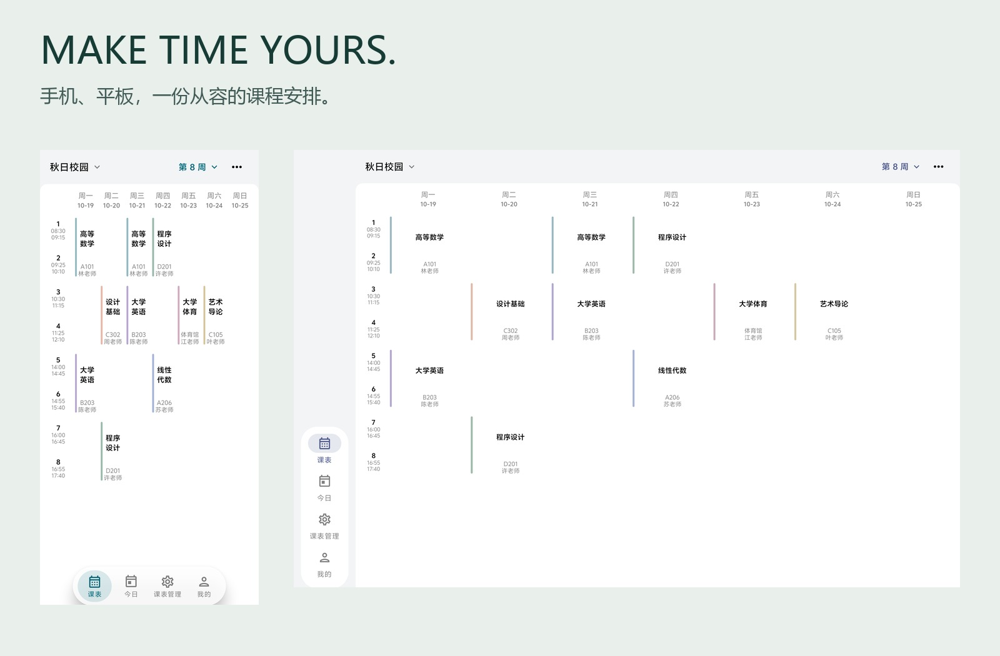

Your timetable should give you clarity at a glance. See the shape of your week, find today's classroom, then get on with your day.

## See Classy in motion.

Two cuts. One idea: make time yours. Press play. Sound on.

### Brand film · 52 seconds

https://github.com/user-attachments/assets/9a90d1ed-8ecb-4a7f-b33d-9435bee4dce9

### Short film · 30.2 seconds

https://github.com/user-attachments/assets/ac7be139-0f8a-4b4d-9d15-6163afba1d20

3:4 format, Chinese and English captions. Films include conceptual motion graphics; actual app screens appear below.

## See the week. Focus on today.

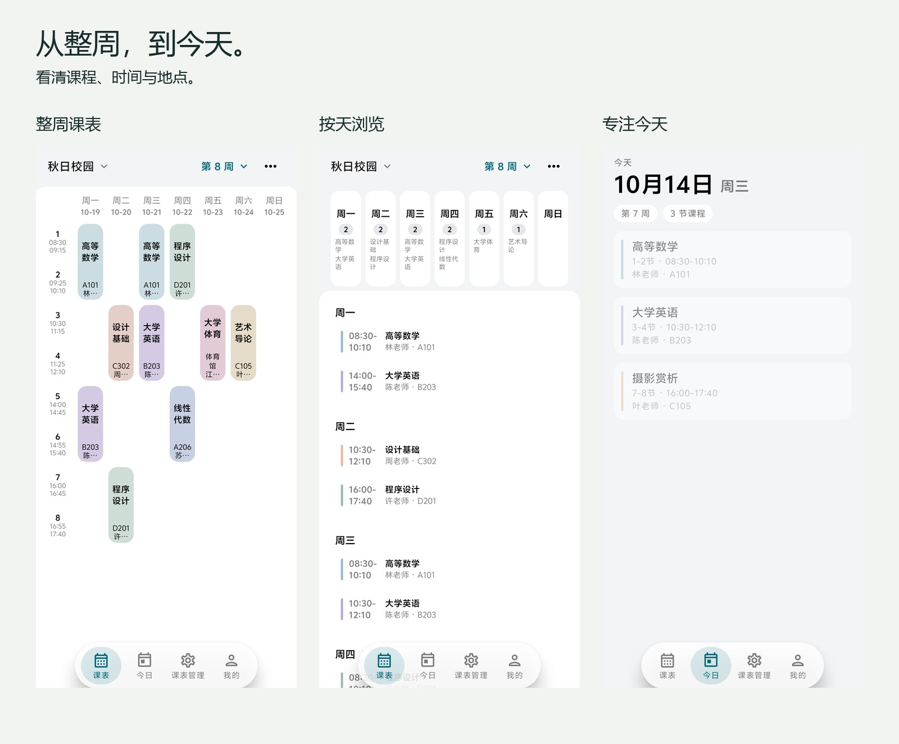

Choose a weekly grid, a day-by-day week view or today's classes. A compact header keeps timetable selection, the week and more actions within reach. Tap a course for details and editing.

Completed classes are dimmed. Weekend classes remain visible normally; holidays and makeup dates can be configured separately. Dimming is a visual cue, not cancellation of a class or its reminder.

## See the whole semester.

See which weeks each course runs, including alternate weeks and courses that start or end midway through the semester. Open a course calendar to find specific dates, times and rooms.

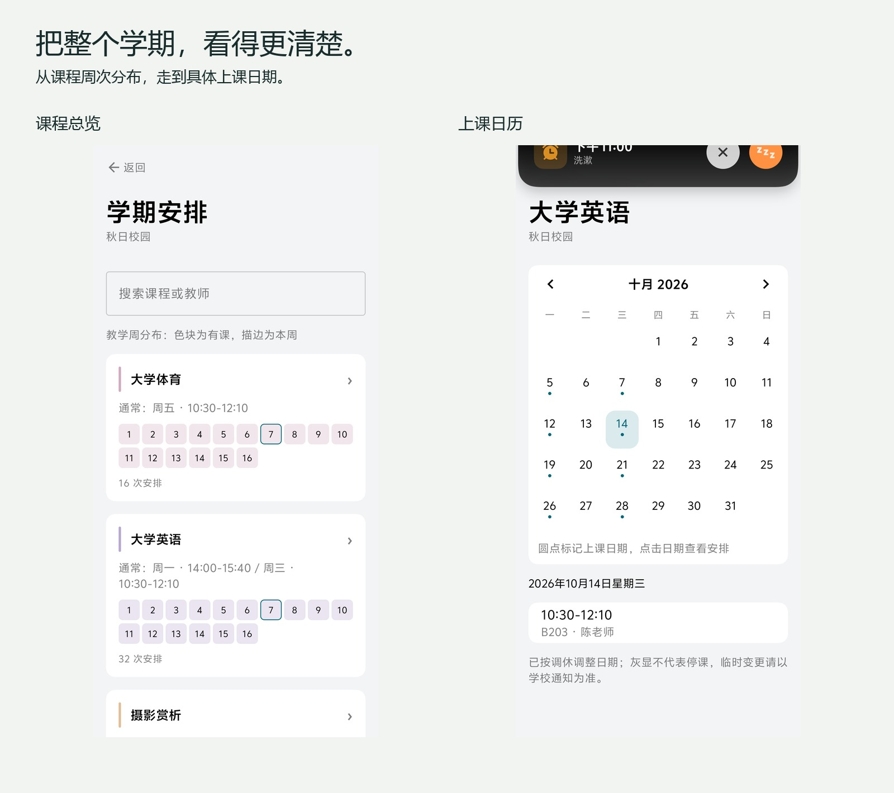

Open **Timetable → More → Semester schedule**.

## One glance, without opening the app.

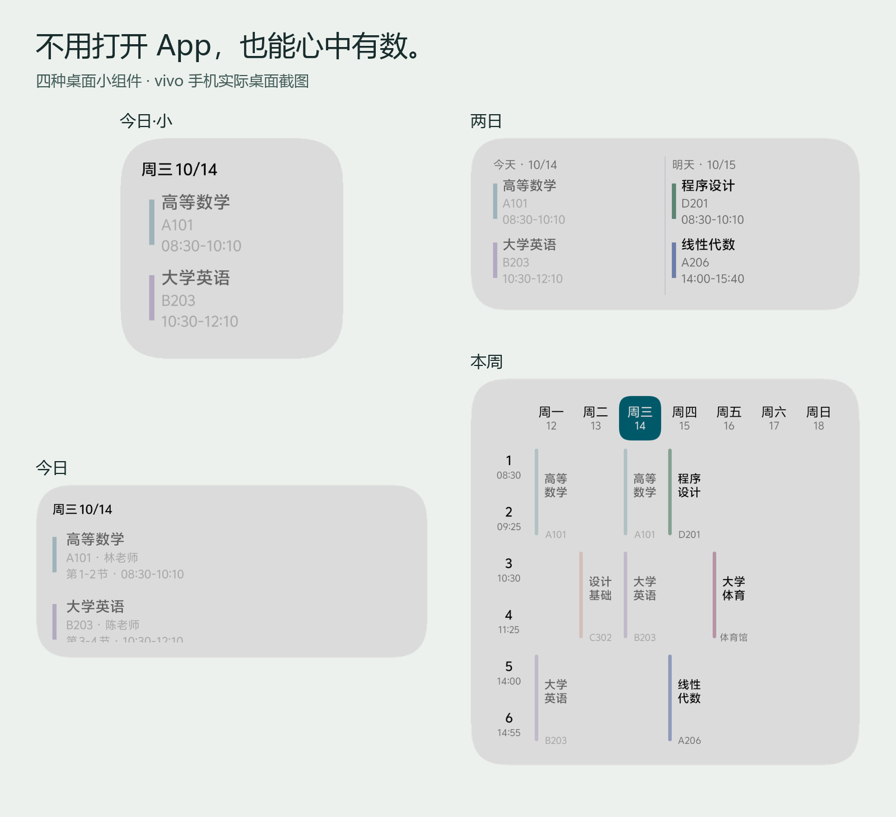

- **Compact today:** a small space for today's classes.
- **Today:** a wider list of courses, times and rooms.
- **Two days:** today and tomorrow side by side.
- **Week:** a weekly grid, with scrolling for later periods.

Assign a timetable, hide its name, and choose the weekly widget's course-title position independently. The weekly grid supports color bars and filled cards. Actual size and visible content depend on the launcher; some launchers require manual widget placement.

## Your timetable. Your colors.

Light and dark themes, soft filled cards or simple color bars. Position course titles at the top or center. Use wallpaper-based dynamic colors on Android 12+, a built-in palette, or your own theme.

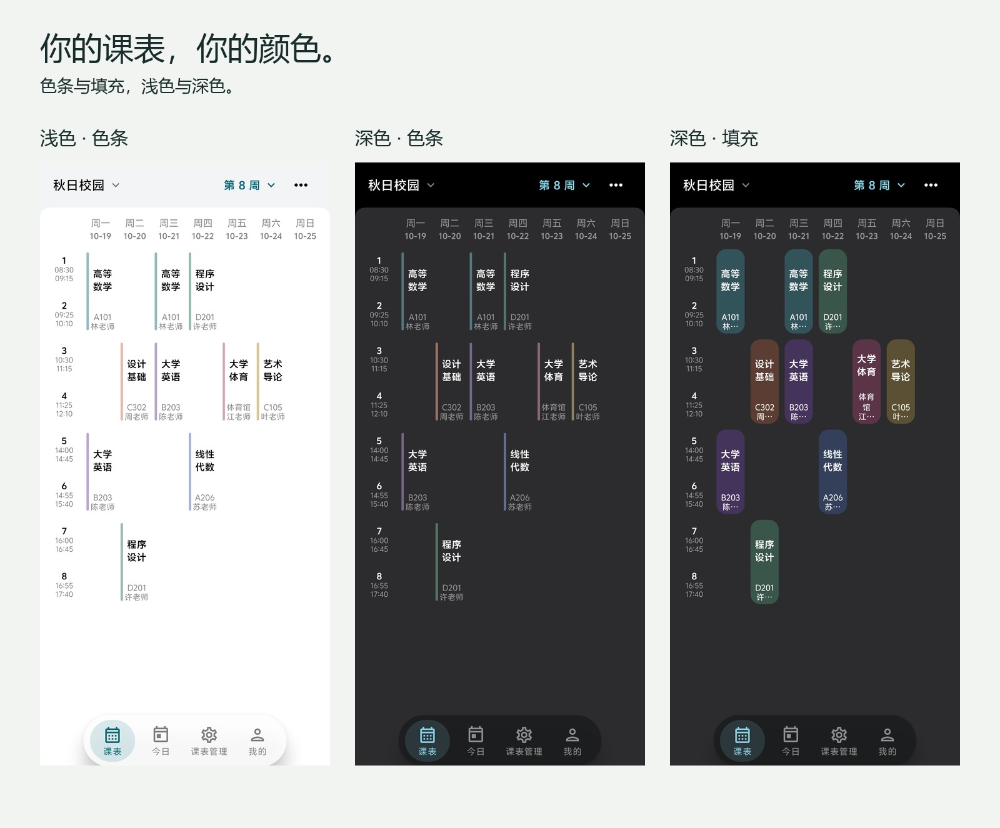

## A background that feels like you.

Pick an image and adjust its strength, blur, saturation and crop position. Keep the atmosphere, while keeping your classes readable.

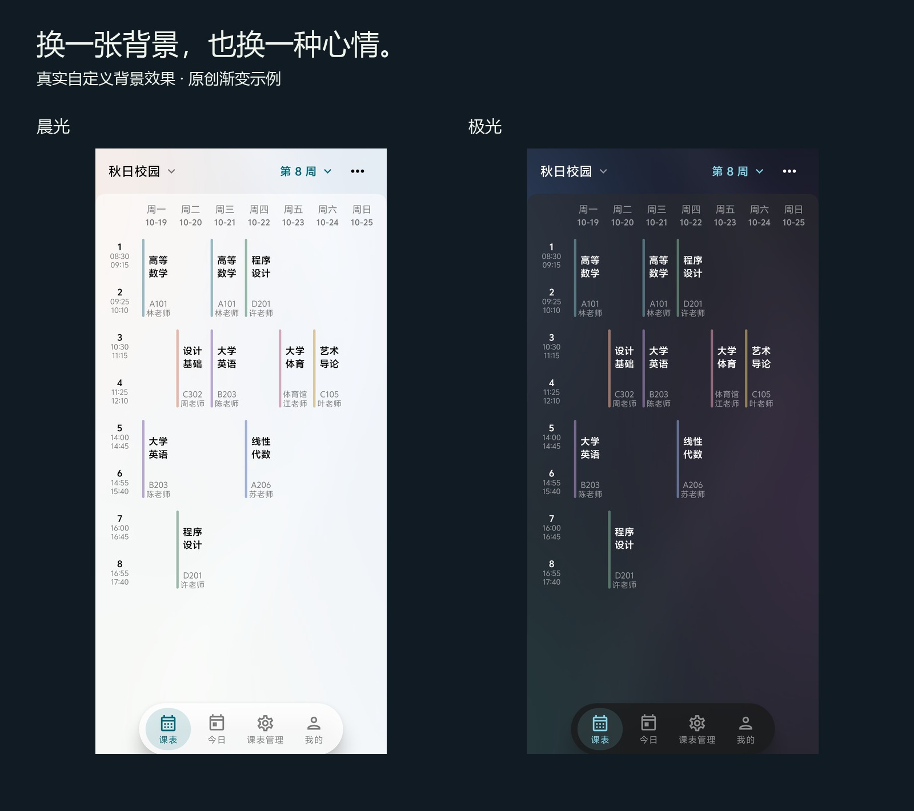

Open **My → Appearance & theme → Timetable background**. These are custom backgrounds, not a liquid-glass mode.

## At home on a tablet.

Wide layouts use side navigation and give the timetable room to breathe. Settings and text pages keep a comfortable reading width. Layouts respond to the available window space.

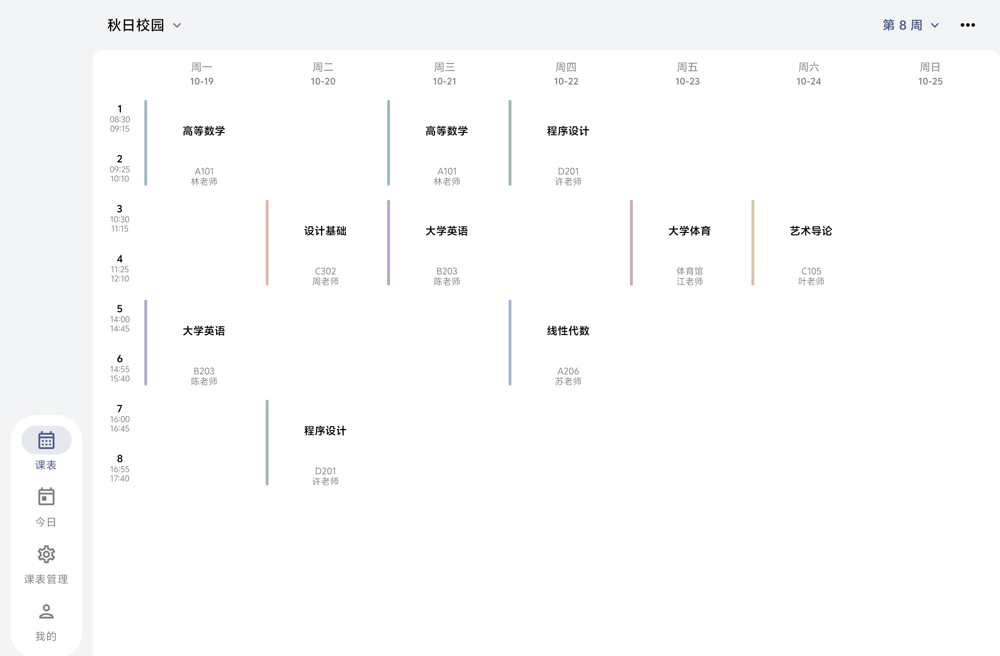

Tablet portrait layouts and home-screen widgets

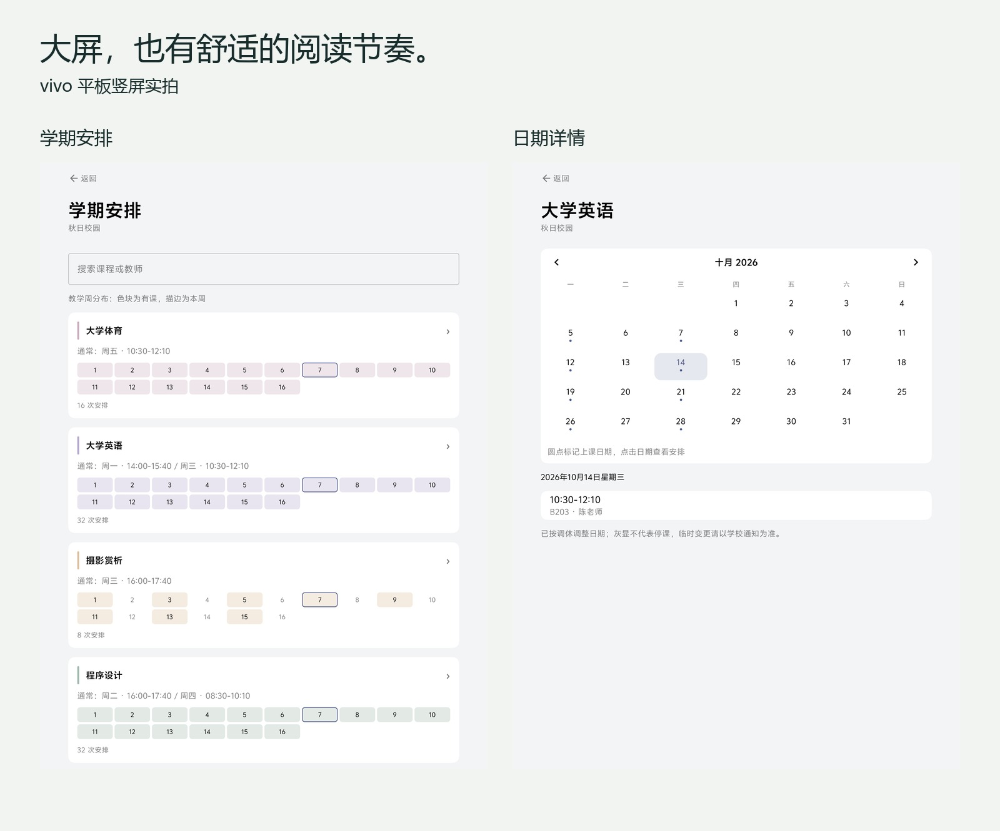

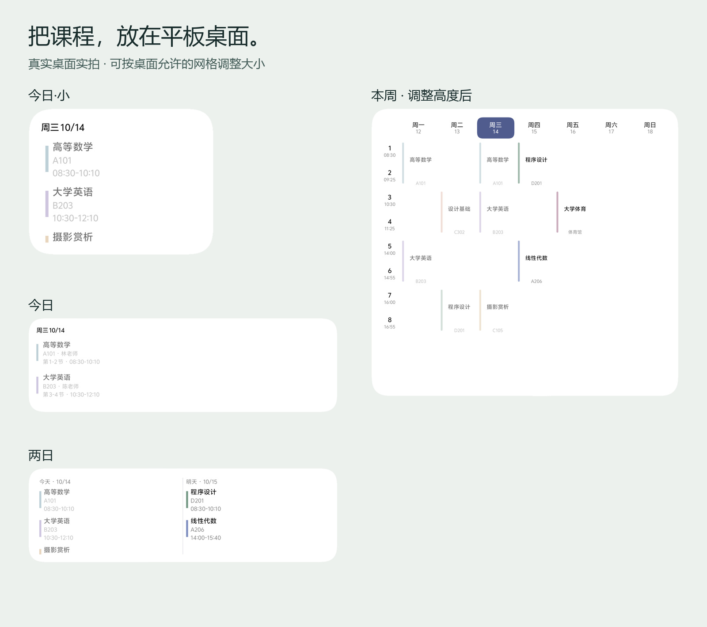

## Thoughtful everyday tools.

| What you need | What Classy offers |
| --- | --- |
| Bring in your timetable | Import from supported academic systems, files or text, with a preview before confirmation |
| Get the latest schedule | Refresh from your school, preserve your daily time schedule and review changes and local edits |
| Adjust classes | Edit courses, make temporary date changes and manage reusable daily time schedules |
| Prepare for the day | Before-class reminders and daily summaries, subject to system permissions and battery restrictions |
| Keep a copy | Export courses and time schedules for backup, sharing or another device |

## Learn by trying.

A skippable welcome helps new users get started. **My → User guide** stays available whenever you need it. Eight topics include interactive examples that do not change your real timetable.

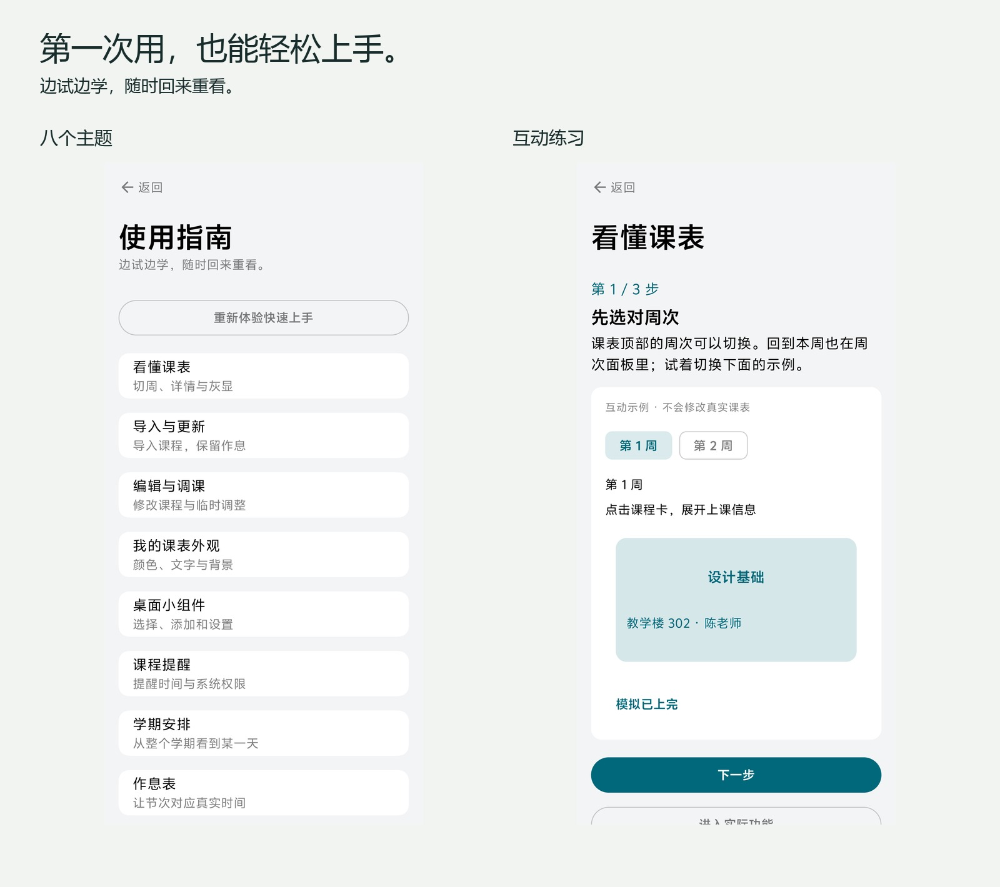

## A little surprise in About.

Press the brand card to tilt it. Tap repeatedly to launch confetti, and keep tapping to keep it going. There may be a letter waiting to be discovered, too.

## Your time. Your data.

- **No ads or advertising/analytics SDKs.**
- **Local-first:** everyday timetable viewing works offline. Academic import, holiday data and update checks use the network.
- **Academic-system parsing runs on your device after school login**, without a Classy relay server. Compatibility depends on the school's system.
- **Import and export:** formats include Classy, ICS, CSV, WakeUp text/JSON and HTML. See the [guide](GUIDE.zh-CN.md#导入与导出) for details.

## Take your timetable with you.

[**Download the latest Android release ↗**](https://github.com/IMSX3D/Classy/releases/latest)

Requires Android 8.0 or later. Most phones and tablets should use **app-arm64-v8a-release.apk**. Other architectures are available on Releases.

An official version with the same signing identity can be upgraded in place. Export a backup first. Preview and official builds are separate apps; export and import to transfer timetables. **My → About → Get update** downloads an update and opens the system installer for confirmation.

[v0.1.1 release notes](../docs/releases/v0.1.1.md) · [Report an issue](https://github.com/IMSX3D/Classy/issues) · QQ **547991704**

Screenshots show the v0.1.1 interface using fictional courses in a Preview build from the same application source. The pictured UI and artwork captions are in Chinese; the app also supports English. Screenshots are cropped around system bars, resized and arranged with external captions. The two original films include historical UI and conceptual motion graphics. See the [asset record](media/v0.1.1/README.md).

## Built in the open.

Classy is a [GPL-3.0](../LICENSE) fork of [lingion/sleepy](https://github.com/lingion/sleepy), with redesigned UI, themes and widgets. Its timetable foundation and academic-system parsers build on the upstream project.

Thanks to [lingion](https://github.com/lingion), [Nevodev](https://github.com/Nevodev) for [Cresto](https://github.com/Nevodev/Cresto) / [Pear Wall](https://github.com/Nevodev/Pear-Wall), and [Kyant0](https://github.com/kyant0) for [shapes](https://github.com/kyant0/shapes) / [backdrop](https://github.com/kyant0/backdrop). Some academic-system parsing algorithms and school URL data derive from [WakeupSchedule_BUPT](https://github.com/dIT8Zv/WakeupSchedule_BUPT). These UI and parser dependencies are credited under their respective Apache-2.0 licences; see the in-app licence page for the full list.

For local development, use JDK 17+ and Android SDK 37; see the [build guide](GUIDE.zh-CN.md#从源码构建). Official Release builds require configured signing credentials; they do not silently fall back to debug signing.

[Contribute](../CONTRIBUTING.md) · [Code of conduct](../CODE_OF_CONDUCT.md) · [Security](../SECURITY.md)
